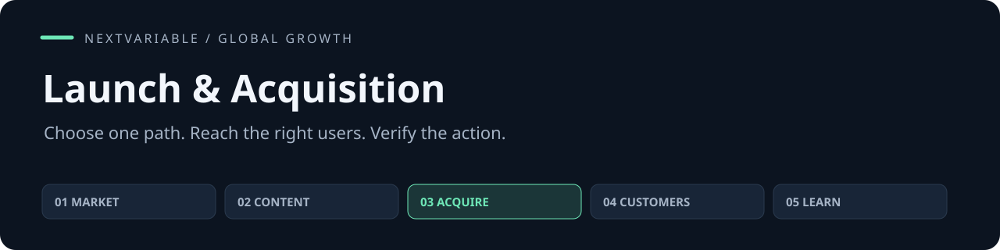

# Launch & Acquisition

**产品发布与渠道获客 · 选择值得先试的海外渠道，准备发布与合作，接住用户，并核实动作是否真的完成。**

[](https://github.com/NextVariable/global-launch-acquisition-skill/actions/workflows/validate.yml) [](LICENSE) [](https://agentskills.io/specification)

[快速开始](#quick-start) · [任务示例](examples/first-task.md) · [方法](#method) · [验证](#validation) · [五个 Skill 合集](https://github.com/NextVariable/global-growth-skills)

输入 **目标用户、现有页面和素材、渠道条件、预算、时间与支持产能**，得到 **渠道选择、发布包、合作提案、排期、承接及核验结果**。可以独立使用；已有项目资料或其他 Skill 的交接都能直接接入。指令以中文编写，对客产物按目标受众选择语言。

## In practice

> 先选一个已有账号的相关社区；创作者邮件作为备用材料，不把未确认的合作当成已锁定流量。
>
> 两周 12 小时闭合：准备 2、参与 1.5、筛选 0.5、支持 6、跟进 1、复盘 1；最多接 4 个新团队。

以上是合成任务的结果节选。[查看输入和完整任务说明 →](examples/first-task.md)

## Quick start

在你的项目目录运行，选择要安装到的客户端：

```sh
npx skills add NextVariable/global-launch-acquisition-skill --skill global-launch-acquisition
```

需要跨项目使用时加 `-g`。此安装方式需要 Node.js 22.20+；也可以直接复制技能目录。

<details>
<summary>手动安装到 Codex（Git；已有目录时停止）</summary>

```sh
git clone https://github.com/NextVariable/global-launch-acquisition-skill.git
cd global-launch-acquisition-skill
mkdir -p "$HOME/.agents/skills"
target="$HOME/.agents/skills/global-launch-acquisition"
if [ -e "$target" ] || [ -L "$target" ]; then
  echo "Already exists: $target"
else
  cp -R skills/global-launch-acquisition "$target"
fi
```

完整保留 `skills/global-launch-acquisition/` 内的方法、模板和许可。已有同名目录时先保存旧版及个人修改，再比较版本；不要把两份目录直接合并。其他客户端使用其配置的 Skill 目录。

</details>

重新加载客户端后调用 `$global-launch-acquisition`。纯 Markdown 方法，无需 Python、服务或专用密钥。

```text
使用 $global-launch-acquisition。
产品与当前阶段：……
这次要解决：……
已确认的能力、材料和限制：……
可投入的时间、预算与人员：……
请完成我需要的产物；未知的关键条件明确说明。
```

项目资料保存在你自己的工作目录，安装包只放通用方法。实际外发、发布、支出或客户系统操作依赖相应工具和授权。

## Method

入口只保留任务判断和必要边界，按需加载相关方法，不要求每次读完或跑完整个流程。

| 方法 | 解决什么 |
|---|---|
| [发布与渠道](skills/global-launch-acquisition/references/launch-and-channels.md) | 从受众倒推渠道，检查承接，安排依赖与预算 |
| [社媒与社区](skills/global-launch-acquisition/references/social-and-community.md) | 具体参与、自有账号、活动和贡献者运营 |
| [合作与创作者](skills/global-launch-acquisition/references/partners-and-creators.md) | 候选、提案、内容包、权利、费用和履约 |
| [发现与生态](skills/global-launch-acquisition/references/discovery-and-ecosystems.md) | 搜索、商店、开源集成、媒体和目录 |
| [执行与恢复](skills/global-launch-acquisition/references/execution-and-recovery.md) | 授权动作、状态回读、去重与故障恢复 |

## Validation

```sh
PYTHONDONTWRITEBYTECODE=1 python3 scripts/validate.py
```

[验证说明](validation/README.md)区分结构与记录检查、计算测试、模型任务和真实业务结果。自动检查不替代语义审阅；合成试用不能证明获客、收入或留存提升。客户端实际加载、目标用户理解和业务效果应在自己的环境验证。

## Ecosystem

[01 市场战略](https://github.com/NextVariable/global-gtm-strategy-skill) → [02 定位内容](https://github.com/NextVariable/global-growth-content-skill) → [03 发布获客](https://github.com/NextVariable/global-launch-acquisition-skill) → [04 客户增长](https://github.com/NextVariable/global-sales-retention-skill) → [05 实验复盘](https://github.com/NextVariable/global-growth-experiments-skill)

五个独立仓库，按当前问题选用。共享产品背景、证据与版本，结果可以回到前面的决策；其他四个不是安装依赖。

## Contributing

改进建议请带一个具体任务、期望结果和实际问题。开发、检查与提交方式见 [CONTRIBUTING.md](CONTRIBUTING.md)；功能问题可提交 [Issue](https://github.com/NextVariable/global-launch-acquisition-skill/issues/new/choose)。

## English

Plan and execute international launches, channel distribution, community participation and creator partnerships. Deliver a concrete path from relevant attention to a supported next action, with verifiable execution status. Install the complete skill directory and invoke `$global-launch-acquisition`. Instructions are Chinese-first; deliverables follow the target audience. Model and external tools are supplied by your client.

[MIT](LICENSE). 安装和再分发时保留随包许可文件。
